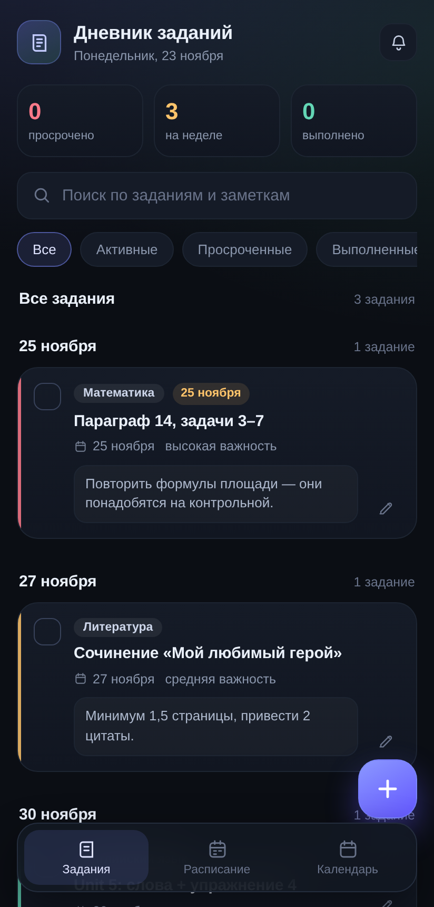
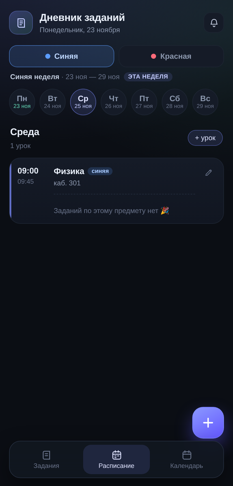
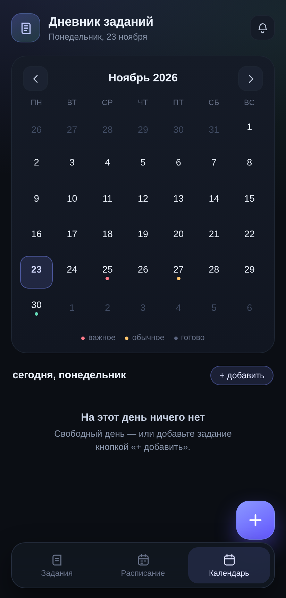

# Задания — дневник учёбы (Android)

Тёмное приложение-дневник для школы: задания по предметам с дедлайнами, приоритетами
и заметками, календарь, расписание уроков с **синей и красной неделей**, системные
напоминания о сроках сдачи.

<p align="center">
  
  
  
</p>

## Что внутри

| Папка | Что это |
|---|---|
| **`apk/`** | Готовый к установке **`Zadaniya-1.1.apk`** (82 КБ, подписан, Android 6+) |
| **`android/`** | Исходники Android-приложения (Java + Gradle, без сторонних библиотек) |
| **`web/`** | PWA-версия для браузера: `index.html`, `style.css`, `app.js`, manifest, service worker |
| **`docs/`** | Инструкция по установке и автономная версия `dnevnik-zadaniy.html` |
| `docs/УСТАНОВКА-APK.md` | Как установить APK и что разрешить для уведомлений |

## Возможности

- **Задания**: название, предмет, срок сдачи, важность (низкая/средняя/высокая), заметка.
- **Список**: группировка по датам (просроченные → сегодня → дальше → выполненные), бейджи
  «сегодня / завтра / просрочено», счётчики сверху (просрочено / на неделе / выполнено).
- **Поиск** по названию, предмету и заметкам, фильтры и фильтр по предмету одним нажатием.
- **Календарь**: точки по важности на днях, выбор дня и задания на этот день, листание месяцев.
- **Расписание уроков**: дни недели с датами, время и кабинет, уроки «каждую неделю»,
  «только синяя» или «только красная» неделя. Задания автоматически привязываются к уроку по
  названию предмета, галочка выполненного синхронизируется с общим списком, текущий урок
  подсвечивается меткой «сейчас».
- **Напоминания**: в APK — системные (`AlarmManager` + канал уведомлений Android), приходят
  в выбранное время за 0–3 дня до срока, работают при закрытом приложении и после
  перезагрузки телефона. В веб-версии — уведомления при открытом приложении и баннер при запуске.
- **Резервная копия**: экспорт и импорт данных в `.json`.
- Работает **офлайн**, данные остаются на устройстве, интернет не используется.

## Установка на телефон

1. Скачайте `apk/Zadaniya-1.1.apk` на телефон.
2. Откройте файл → разрешите установку из этого источника → «Установить».
3. В приложении: 🔔 → включить напоминания, выбрать время и за сколько дней напоминать.

Подробности и решение проблем с уведомлениями (Xiaomi, Samsung, Realme) —
в [`docs/УСТАНОВКА-APK.md`](docs/УСТАНОВКА-APK.md).

Веб-версия: откройте `web/index.html` через любой хостинг (GitHub Pages, Netlify)
и установите как PWA, либо используйте автономный `docs/dnevnik-zadaniy.html`.

## Сборка APK из исходников

Нужны JDK 17 и Android SDK 34 — скрипт установит их сам:

```bash
bash android/setup_sdk.sh     # JDK 17 + Android SDK (cmdline-tools, platform 34)
bash android/build_apk.sh     # сборка → android/build/outputs/apk/release/Zadaniya-release.apk
```

Структура нативного проекта:

```
android/src/main/
├── AndroidManifest.xml
├── assets/www/                     веб-интерфейс приложения
├── java/com/arena/zadaniya/
│   ├── MainActivity.java           WebView + мост JavaScript ↔ Android
│   ├── NativeStore.java            хранилище состояния + планирование AlarmManager
│   ├── ReminderReceiver.java       показ уведомления о дедлайне
│   └── BootReceiver.java           перепланирование после перезагрузки
└── res/                            иконки, тема, строки
```

Ключ подписи `android/keystore.jks` (alias `zadaniya`, пароль `zadaniya123`) лежит в репозитории,
чтобы APK собирался одной командой. Для публикации в Google Play создайте собственный
ключ и `bundleRelease` — и не храните ключ в публичном репозитории.

## Технологии

Java 17, Android SDK 34 (minSdk 23), Gradle 8.7, AGP 8.5. Ванильный JavaScript без фреймворков,
`localStorage` + файл приложения для хранения данных.

## Лицензия

MIT — используйте, изменяйте и распространяйте свободно.
